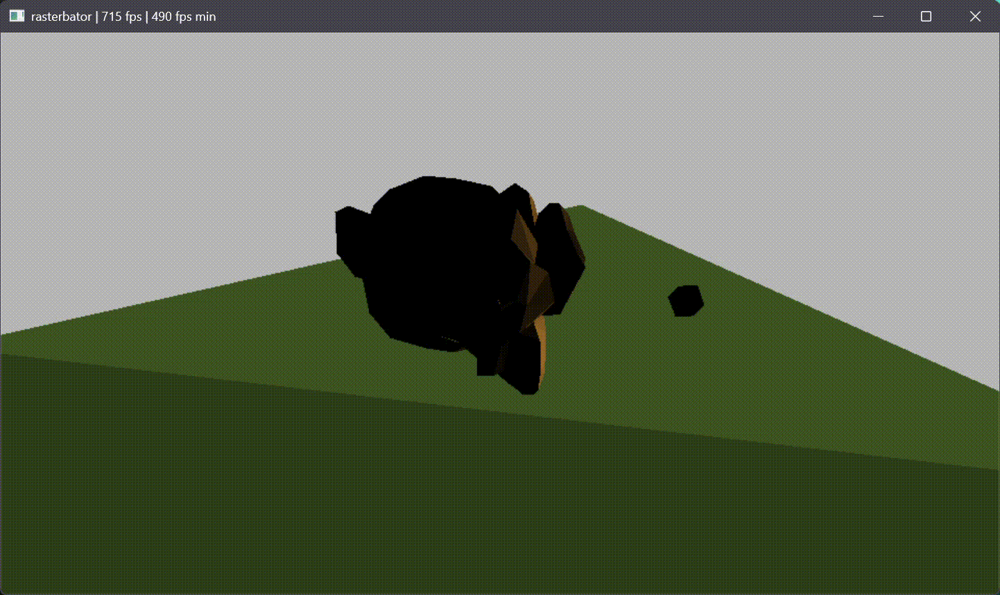

# Rasterbator (ik very funny)

A software rasterizer in C from scratch.

can draw 3D shi onto a 2D screen in real time!



## Build

Build the builtin car test using cmake wrapped with make.

Two window backends are available:

- **SDL3** (Defaul and auto installed when running make)

```sh
make
```

- **Win32**:

```sh
make win
```

Targets and knobs:

```sh
make debug                 # debug symbols
make run                   # release, then run
make clean                 # remove build dirs + binaries

make BACKEND=win32         # backend for release/debug: sdl (default) | win32
make SHARED=ON             # build rasterbator as a shared library
make EXAMPLES=OFF          # build the library only, no cartest
make WIN32_ENTRY=OFF       # don't compile wWinMain into the win32 backend
make BUILD=build-clang CC=clang
```

> [!IMPORTANT]
> Windows builds default to the MinGW/clang toolchain (override with `CC=...`
> and `GEN=...`). The MSVC build currently crashes at runtime with heap
> corruption (`0xC0000374`) — stick to MinGW/clang.

## Test

Run the builtin car test.

```sh
./bin/cartest
```

Ts (this) opens a window with real-time rendering. Assets are resolved relative
to the executable, so run it from the repo root.

> [!TIP]
> Directly use ts if you don't hate yourself.
>
> ```sh
> make && ./bin/cartest
> ```
